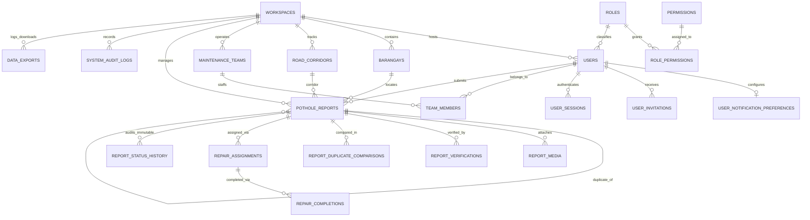
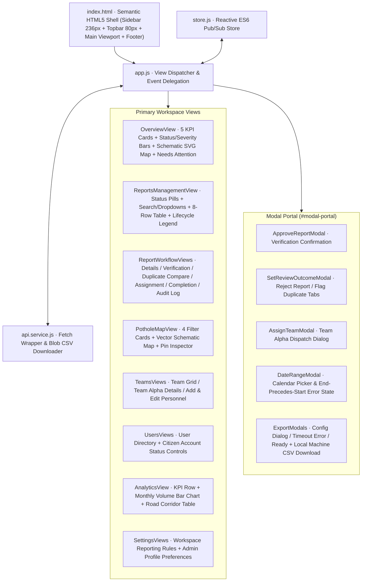

# LUBA CanFindIT · Master Execution Blueprint (Developer Handoff Specification)

> [!IMPORTANT]
> **Purpose of This Document**: This is a **self-contained Master Execution Blueprint** reverse-engineered from all **26 exported Figma screens** for **LUBA CanFindIT (Quezon City Engineering Department · LGU Road Operations Admin Panel)**. It is designed for direct handoff to implementation developers and sub-agents without requiring external architectural guesswork.
>
> **Locked Architectural Decisions**:
> 1. **Production Map Component**: Retain the **self-contained SVG Vector Schematic Map** (`LUBA canFindIT · Illustrative map / QC`) with interactive severity pin overlays in production (zero external map tile dependencies or API keys required).
> 2. **Local Machine CSV / PDF Export**: Generate exports on the fly and stream them directly to the user's browser (`Content-Disposition: attachment; filename="LUBA canFindIT_QC_YYYY-MM-DD.csv"`) so any authorized user downloads the file straight to their local computer's `Downloads` folder without cloud storage infrastructure.

---

## 0. Forensic Inventory of All 26 Figma Screens

| # | Figma Screen File | Breadcrumb / Context | Core UI Components & Business Rules |
| :--- | :--- | :--- | :--- |
| 1 | `Admin · Operations overview.png` | `Administration / Overview` | 5 KPI cards (`1,284` total, `98` pending, `186` verified, `214` in progress, `620` resolved), 8-status bar chart, 3-tier severity stacked bar, Pothole map preview, and `Needs attention` queue. |
| 2 | `Admin · Reports management.png` | `Administration / Reports` | 6 status filter pills, search input, status/severity/month dropdowns, 8-row paginated table (`RW-2026-0842` to `RW-2026-0835`), and 8-badge lifecycle legend card. |
| 3 | `Admin · Report details.png` | `Administration / Reports` | Detailed view for `RW-2026-0842` (`Commonwealth Avenue`), citizen photo (`2.4 MB`), GPS coordinates (`14.6978° N, 121.0881° E ±8 m`), restricted citizen PII card (`Mika Reyes`), and vertical status timeline. |
| 4 | `Admin · Verification review.png` | `Administration / Reports` | `Under Review → Verified` split workspace: 4-item review checklist, `Not a duplicate` green callout (`RW-2026-0819` 38 m away), segmented severity selector (`Low` / `Medium` / `● High`), required notes, and `Approve & mark Verified` CTA. |
| 5 | `Admin · Approve report confirmation.png` | Modal over `Verification` | `Approve this report?` confirmation dialog enforcing `"Verification is not resolution"` policy and immutable audit reason capture. |
| 6 | `Admin · Reject report confirmation.png` | Modal over `Reports` | `Set review outcome` modal (`Reject report` tab active) for `RW-2026-0844` (`Outside Quezon City jurisdiction`), danger callout, citizen-visible reason, and red `Confirm as Rejected` button. |
| 7 | `Admin · Rejection and duplicate outcome dialog.png` | Modal over `Reports` | `Set review outcome` modal (`Flag duplicate` tab active) linking `RW-2026-0835` to parent `RW-2026-0826 · Aurora Boulevard` (`12 m away`). |
| 8 | `Admin · Duplicate report comparison.png` | `Administration / Reports` | Side-by-side spatial & photo comparison between candidate `RW-2026-0842` (Northbound) and existing `RW-2026-0819` (Southbound, 38 m apart), with dual-pin map and `Keep as distinct report` CTA. |
| 9 | `Admin · Team assignment modal.png` | Modal over `Reports` | `Assign a repair team` dialog selecting `QC North · Team Alpha` (`Engr. Paolo Santos`, `4 crew · Asphalt repair · 2.1 km away`), target completion `21 Oct 2026 · 5:00 PM`, and safety instructions. |
| 10 | `Admin · Assignment review and confirmation.png` | `Administration / Reports` | Post-assignment confirmation state (`Verified → Assigned`) separating editable `Assignment priority` (`High`/`Medium`/`Low`) from verified road damage severity. |
| 11 | `Admin · Repair completion review.png` | `Administration / Reports` | Side-by-side **Before repair** (`20 Oct · 8:05 AM`) and **After repair** (`21 Oct · 10:35 AM`) photo inspection, materials summary (`Hot-mix asphalt · 4 bags / ~200 kg`), 4-point LGU inspection checklist, `Approve repair & mark Resolved`, and `Return to team for rework`. |
| 12 | `Admin · Report status history and audit log.png` | `Administration / Reports` | Read-only, append-only 10-event audit table (`19 Oct · 09:24` to `21 Oct · 11:20`) with status and inclusive PHT date filters. |
| 13 | `Admin · Pothole map.png` | `Administration / Pothole map` | Interactive citywide vector schematic map with 4 filter cards, `All statuses` / `Open only` / `Resolved` mode pills, pin inspector card, and `Public map privacy` PII redaction notice. |
| 14 | `Admin · Maintenance team management.png` | `Administration / Teams` | 4 KPI cards (`8` active teams, `48` field personnel, `128` assigned, `214` in progress) and 2×2 team grid (`Team Alpha`, `Team Bravo`, `Team Charlie`, `Team Delta`). |
| 15 | `Admin · Maintenance team details.png` | `Administration / Teams` | `QC North · Team Alpha` profile, lead card (`Engr. Paolo Santos`), workload card (`8 Assigned · 3 In Progress`), 4-row crew table, assigned task list, and task ownership protection banner. |
| 16 | `Admin · Add maintenance personnel.png` | `Administration / Teams` | **Form Error State**: Red validation border (`#B93838`) on incomplete Philippine mobile number (`+63 917 000`), disabled `Save & send invitation` button (`#E7ECF2`), and 7-day invitation expiry policy. |
| 17 | `Admin · Edit maintenance personnel.png` | `Administration / Teams` | Personnel editor for `Engr. Paolo Santos` with `On duty` / `Unavailable` / `On leave` pills and explicit task handover protection (`Review task handover`). |
| 18 | `Admin · User management.png` | `Administration / Users` | 4 KPI cards (`3,842` citizens, `12` LGU admins, `48` maintenance personnel, `3` pending invitations), 5 role filter tabs, and 8-row user directory table. |
| 19 | `Admin · User details and account management.png` | `Administration / Users` | Citizen profile (`Mika Reyes`), restricted PII notice, recent reports table, and `Account status controls` (`Active` / `Suspended`) requiring a reason and privilege-separation checkbox acknowledgement. |
| 20 | `Admin · Analytics and exports.png` | `Administration / Analytics` | 4 KPI cards (`1,284` received, `48.3%` resolution rate, `2.4 h` median first review, `2.8 d` median repair time), May–Oct grouped bar chart, and 5-row `Road-level summary` table. |
| 21 | `Admin · Date-range filters.png` | Modal over `Analytics` | **Validation Error State**: `Choose a date range` calendar modal where `From` (`21 Oct 2026`) > `To` (`19 Oct 2026`), triggering `Invalid range · end precedes start` and disabling `Apply range`. |
| 22 | `Admin · Export CSV or PDF dialog.png` | Modal over `Analytics` | `Export reports` dialog (`CSV` / `PDF`, `Current filters` / `All reports`), 5-item field checklist with `Citizen name, email and phone` unchecked by default (`Personal data excluded by default`). |
| 23 | `Admin · Export generation error.png` | Modal over `Analytics` | **Timeout Error State**: `We couldn't generate your export` (`No file was created`), retained selection summary, support reference `EXP-QC-20261021-1203`, and `Retry generation` CTA. |
| 24 | `Admin · Export success.png` | Modal over `Analytics` | **Success State**: `Your export is ready` (`LUBA canFindIT_QC_2026-10-21.csv`, `246 KB`, `1.8 MB` PDF summary) with direct browser download buttons (`Download CSV` / `Download PDF summary`). |
| 25 | `Admin · Administrator profile.png` | `Administration / Settings` | Personal profile for `Ana Dela Cruz`, notification switches (`Review queue alerts`, `Completion review alerts`, `Daily email summary`), locked `Sign-in security notices`, and green save feedback toast. |
| 26 | `Admin · Workspace settings.png` | `Administration / Settings` | LGU policy configuration: `50 meters` duplicate radius, SLA targets (`48 hours` High, `5 days` Medium, `14 days` Low), workflow policy toggles, citizen notification toggles, and `Service jurisdiction` card. |

---

## Phase 1: Design System & Token Mapping

### 1.1 Pixel-Sampled Color Palette & Semantic Tokens

| Token Key | Tailwind Utility Class | Hex Code | Exact Figma Element Usage |
| :--- | :--- | :--- | :--- |
| `luba.navy` | `bg-luba-navy` / `text-luba-navy` | `#102D4F` | Fixed left sidebar (`236px`), H1/H2 headings, active filter pills (`All reports 1,284`, `CSV`, `Custom`). |
| `luba.navyActive` | `bg-luba-navyActive` | `#1E3959` | Active sidebar navigation item fill (`Overview`, `Reports`, `Pothole map`, `Users`, `Teams`, `Analytics`, `Settings`). |
| `luba.canvas` | `bg-luba-canvas` | `#F3F6FA` | Main viewport background canvas (`x >= 236, y >= 80`). |
| `luba.surface` | `bg-luba-surface` | `#FFFFFF` | Card containers, top header bar (`80px`), data tables, and modal surfaces. |
| `luba.tableHeader` | `bg-luba-tableHeader` | `#EDF2F7` | Uppercase table header row (`REPORT ID`, `ROAD`, `BARANGAY`, `SEVERITY`, `STATUS`, `REPORTED`) and progress bar track. |
| `luba.border` | `border-luba-border` | `#DEE6EE` | 1px card borders, table row dividers, input outlines, and header bottom divider. |
| `luba.cta` | `bg-luba-cta` / `text-luba-cta` | `#D95820` | Primary CTA buttons (`Start verification`, `Approve & mark Verified`, `Confirm assignment`, `Download CSV`), `Medium` severity bar, and sidebar badge count (`98`). |
| `luba.info` | `text-luba-info` / `bg-luba-info` | `#225A91` | Clickable report IDs (`RW-2026-0842`), `Low` severity bar, status bars, and info banner copy. |
| `luba.infoBg` | `bg-luba-infoBg` | `#EAF2FC` | Info banners (`98 reports need a first review`, `Restricted personal data`, `Read-only history`) and `Submitted` / `Verified` / `Assigned` / `In Progress` / `Low` pills. |
| `luba.warningText` | `text-luba-warningText` | `#9A5B13` | `Under Review` and `Awaiting review` badge text and warning banner text. |
| `luba.warningBg` | `bg-luba-warningBg` | `#FFF4D9` | `Under Review` badge fill, `Awaiting LGU approval` banner, `Ongoing task ownership is protected` callout. |
| `luba.success` | `text-luba-success` / `bg-luba-success` | `#197653` | `Resolved` / `Active` / `Approved` badge text, `Resolved` status bar, `All systems operational` footer dot. |
| `luba.successBg` | `bg-luba-successBg` | `#E8F5EE` | `Resolved` / `Active` pill fill, `Not a duplicate` callout, `Your export is ready` banner. |
| `luba.danger` | `bg-luba-danger` / `text-luba-danger` | `#B93838` | `High` severity bar & text, `Rejected` status text, `Confirm as Rejected` button, and input error borders (`+63 917 000`). |
| `luba.dangerBg` | `bg-luba-dangerBg` | `#FCECEC` | `High` & `Rejected` pill fill, `Confirm rejection` callout, `Invalid range · end precedes start` banner. |
| `luba.neutralBg` | `bg-luba-neutralBg` | `#E7ECF2` | `Duplicate` status pill fill and disabled primary CTA buttons (`Save & send invitation`, `Apply range`, `Confirm status change`). |
| `luba.textSecondary` | `text-luba-textSecondary` | `#32475D` | Standard table cell copy and narrative descriptions. |
| `luba.textMuted` | `text-luba-textMuted` | `#506274` | Form labels, checklist items, and secondary labels. |
| `luba.textSubtle` | `text-luba-textSubtle` | `#607287` | Subtitles, PHT timestamps, breadcrumbs, and footer metadata. |

### 1.2 Typography, Spacing & Grid Dimensions

- **Font Stack**: `Inter, system-ui, -apple-system, BlinkMacSystemFont, "Segoe UI", Roboto, sans-serif`
- **Frame & Shell Dimensions**:
  - **Reference Desktop Viewport**: `1440px` width
  - **Left Sidebar**: Fixed `236px` width (`w-sidebar`), `#102D4F` background, `16px` horizontal padding (`px-4`), `24px` vertical padding (`py-6`)
  - **Top Header Bar**: `80px` height (`h-topbar`), `#FFFFFF` background, `1px` bottom border `#DEE6EE`, `32px` horizontal padding (`px-8`)
  - **Content Area**: `max-w-[1200px] mx-auto p-8`, 12-column layout grid (`grid-cols-1 lg:grid-cols-12 gap-5`)
  - **Card Radius & Border**: `rounded-[12px]` (`rounded-card`), `1px solid #DEE6EE`
  - **Modal Dialog Container**: `max-w-lg` (`512px`–`560px`), `rounded-[16px]` (`rounded-modal`), `p-6`, backdrop `bg-[#102D4F]/60`

### 1.3 Component Variant & State Matrix

| Component Variant | Default State | Hover / Focus State | Active / Selected State | Disabled State | Error State |
| :--- | :--- | :--- | :--- | :--- | :--- |
| **Primary CTA Button** | `bg-luba-cta text-white font-bold rounded-control` | `hover:bg-luba-ctaHover focus:ring-2 focus:ring-luba-cta/40` | `bg-[#B54413]` | `bg-luba-neutralBg text-luba-textSubtle cursor-not-allowed` | N/A |
| **Danger CTA Button** | `bg-luba-danger text-white font-bold rounded-control` | `hover:bg-[#9E2E2E]` | `bg-[#872525]` | `bg-luba-neutralBg text-luba-textSubtle` | N/A |
| **Secondary Outline Button** | `bg-white border border-luba-border text-luba-textPrimary font-bold` | `hover:bg-luba-canvas` | `bg-luba-tableHeader` | `opacity-50 cursor-not-allowed` | N/A |
| **Filter / Mode Pill** | `bg-white border border-luba-border text-luba-textPrimary` | `hover:bg-luba-canvas` | `bg-luba-navy text-white border-luba-navy` | `opacity-50 pointer-events-none` | N/A |
| **Severity Selector Button** | `bg-white border border-luba-border text-luba-textPrimary` | `hover:border-luba-borderStrong` | `border-2 border-luba-cta bg-orange-50/40 text-luba-cta` | `bg-luba-canvas text-luba-textSubtle` | `border-2 border-luba-danger` |
| **Form Field Container** | `bg-white border border-luba-border rounded-control p-3.5` | `focus-within:border-luba-info` | `border-luba-info` | `bg-luba-canvas text-luba-textSubtle` | `border-2 border-luba-danger` + `text-xs text-luba-danger` helper |

### 1.4 Tailwind Configuration Extension (`tailwind.config.js`)

```javascript
window.tailwind = window.tailwind || {};
window.tailwind.config = {
  theme: {
    extend: {
      fontFamily: {
        sans: ['Inter', 'system-ui', '-apple-system', 'BlinkMacSystemFont', 'Segoe UI', 'Roboto', 'sans-serif']
      },
      colors: {
        luba: {
          navy: '#102D4F',
          navyActive: '#1E3959',
          navyMuted: '#2E4765',
          canvas: '#F3F6FA',
          surface: '#FFFFFF',
          tableHeader: '#EDF2F7',
          border: '#DEE6EE',
          borderStrong: '#CED5DD',
          textPrimary: '#102D4F',
          textSecondary: '#32475D',
          textMuted: '#506274',
          textSubtle: '#607287',
          cta: '#D95820',
          ctaHover: '#C04B17',
          info: '#225A91',
          infoBg: '#EAF2FC',
          warningText: '#9A5B13',
          warningBg: '#FFF4D9',
          success: '#197653',
          successBg: '#E8F5EE',
          danger: '#B93838',
          dangerBg: '#FCECEC',
          neutralBg: '#E7ECF2'
        }
      },
      spacing: {
        sidebar: '236px',
        topbar: '80px'
      },
      borderRadius: {
        card: '12px',
        modal: '16px',
        control: '8px'
      },
      boxShadow: {
        card: '0 1px 2px 0 rgba(16, 45, 79, 0.04)',
        modal: '0 20px 45px -10px rgba(16, 45, 79, 0.28)'
      }
    }
  }
};
```

---

## Phase 2: MySQL Database Schema (3NF Normalized)

### 2.1 Entity-Relationship Diagram



### 2.2 Complete MySQL 8.0+ DDL Script (`schema.sql`)

```sql
SET NAMES utf8mb4;
SET time_zone = '+08:00';
SET FOREIGN_KEY_CHECKS = 0;

CREATE DATABASE IF NOT EXISTS `luba_canfindit`
  CHARACTER SET utf8mb4
  COLLATE utf8mb4_unicode_ci;

USE `luba_canfindit`;

-- 1. WORKSPACES & LGU JURISDICTION SETTINGS ("Admin · Workspace settings.png")
CREATE TABLE `workspaces` (
  `workspace_id` INT UNSIGNED NOT NULL AUTO_INCREMENT,
  `workspace_code` VARCHAR(32) NOT NULL,
  `lgu_name` VARCHAR(120) NOT NULL DEFAULT 'Quezon City',
  `department_name` VARCHAR(160) NOT NULL DEFAULT 'City Engineering Department',
  `public_hotline` VARCHAR(32) NOT NULL DEFAULT '122',
  `timezone` VARCHAR(64) NOT NULL DEFAULT 'Asia/Manila',
  `duplicate_radius_meters` SMALLINT UNSIGNED NOT NULL DEFAULT 50,
  `sla_high_hours` SMALLINT UNSIGNED NOT NULL DEFAULT 48,
  `sla_medium_days` TINYINT UNSIGNED NOT NULL DEFAULT 5,
  `sla_low_days` TINYINT UNSIGNED NOT NULL DEFAULT 14,
  `require_photo` TINYINT(1) NOT NULL DEFAULT 1,
  `require_admin_verification_before_resolution` TINYINT(1) NOT NULL DEFAULT 1,
  `enable_nearby_duplicate_checks` TINYINT(1) NOT NULL DEFAULT 1,
  `notify_citizen_status_change` TINYINT(1) NOT NULL DEFAULT 1,
  `request_post_repair_feedback` TINYINT(1) NOT NULL DEFAULT 1,
  `send_email_update_digest` TINYINT(1) NOT NULL DEFAULT 0,
  `updated_by_user_id` BIGINT UNSIGNED NULL,
  `created_at` DATETIME NOT NULL DEFAULT CURRENT_TIMESTAMP,
  `updated_at` DATETIME NOT NULL DEFAULT CURRENT_TIMESTAMP ON UPDATE CURRENT_TIMESTAMP,
  PRIMARY KEY (`workspace_id`),
  UNIQUE KEY `uk_workspaces_code` (`workspace_code`)
) ENGINE=InnoDB DEFAULT CHARSET=utf8mb4 COLLATE=utf8mb4_unicode_ci;

-- 2. RBAC ROLES & PERMISSIONS ("Admin · User management.png")
CREATE TABLE `roles` (
  `role_id` TINYINT UNSIGNED NOT NULL AUTO_INCREMENT,
  `role_slug` VARCHAR(40) NOT NULL COMMENT 'lgu_admin, lgu_reviewer, maintenance_lead, maintenance_crew, citizen',
  `role_display_name` VARCHAR(80) NOT NULL,
  `is_staff_role` TINYINT(1) NOT NULL DEFAULT 0,
  `grants_admin_console` TINYINT(1) NOT NULL DEFAULT 0,
  `description` VARCHAR(255) NOT NULL,
  `created_at` DATETIME NOT NULL DEFAULT CURRENT_TIMESTAMP,
  PRIMARY KEY (`role_id`),
  UNIQUE KEY `uk_roles_slug` (`role_slug`)
) ENGINE=InnoDB DEFAULT CHARSET=utf8mb4 COLLATE=utf8mb4_unicode_ci;

CREATE TABLE `permissions` (
  `permission_id` SMALLINT UNSIGNED NOT NULL AUTO_INCREMENT,
  `permission_key` VARCHAR(80) NOT NULL,
  `module_name` VARCHAR(40) NOT NULL,
  `description` VARCHAR(255) NOT NULL,
  PRIMARY KEY (`permission_id`),
  UNIQUE KEY `uk_permissions_key` (`permission_key`)
) ENGINE=InnoDB DEFAULT CHARSET=utf8mb4 COLLATE=utf8mb4_unicode_ci;

CREATE TABLE `role_permissions` (
  `role_id` TINYINT UNSIGNED NOT NULL,
  `permission_id` SMALLINT UNSIGNED NOT NULL,
  `granted_at` DATETIME NOT NULL DEFAULT CURRENT_TIMESTAMP,
  PRIMARY KEY (`role_id`, `permission_id`),
  CONSTRAINT `fk_rp_role` FOREIGN KEY (`role_id`) REFERENCES `roles` (`role_id`) ON DELETE CASCADE,
  CONSTRAINT `fk_rp_permission` FOREIGN KEY (`permission_id`) REFERENCES `permissions` (`permission_id`) ON DELETE CASCADE
) ENGINE=InnoDB DEFAULT CHARSET=utf8mb4 COLLATE=utf8mb4_unicode_ci;

-- 3. BARANGAYS & ROAD CORRIDORS ("Admin · Pothole map.png", "Admin · Analytics and exports.png")
CREATE TABLE `barangays` (
  `barangay_id` SMALLINT UNSIGNED NOT NULL AUTO_INCREMENT,
  `workspace_id` INT UNSIGNED NOT NULL DEFAULT 1,
  `barangay_name` VARCHAR(100) NOT NULL,
  `district_name` VARCHAR(60) NOT NULL,
  `center_lat` DECIMAL(10,7) NULL,
  `center_lng` DECIMAL(10,7) NULL,
  PRIMARY KEY (`barangay_id`),
  UNIQUE KEY `uk_barangay_workspace_name` (`workspace_id`, `barangay_name`),
  KEY `idx_barangay_district` (`district_name`),
  CONSTRAINT `fk_barangay_workspace` FOREIGN KEY (`workspace_id`) REFERENCES `workspaces` (`workspace_id`)
) ENGINE=InnoDB DEFAULT CHARSET=utf8mb4 COLLATE=utf8mb4_unicode_ci;

CREATE TABLE `road_corridors` (
  `corridor_id` INT UNSIGNED NOT NULL AUTO_INCREMENT,
  `workspace_id` INT UNSIGNED NOT NULL DEFAULT 1,
  `road_name` VARCHAR(140) NOT NULL,
  `primary_barangay_id` SMALLINT UNSIGNED NULL,
  `is_high_traffic` TINYINT(1) NOT NULL DEFAULT 1,
  PRIMARY KEY (`corridor_id`),
  UNIQUE KEY `uk_corridor_workspace_road` (`workspace_id`, `road_name`),
  CONSTRAINT `fk_corridor_workspace` FOREIGN KEY (`workspace_id`) REFERENCES `workspaces` (`workspace_id`),
  CONSTRAINT `fk_corridor_barangay` FOREIGN KEY (`primary_barangay_id`) REFERENCES `barangays` (`barangay_id`)
) ENGINE=InnoDB DEFAULT CHARSET=utf8mb4 COLLATE=utf8mb4_unicode_ci;

-- 4. USERS, PREFERENCES, INVITATIONS & SESSIONS ("Admin · User details and account management.png")
CREATE TABLE `users` (
  `user_id` BIGINT UNSIGNED NOT NULL AUTO_INCREMENT,
  `workspace_id` INT UNSIGNED NOT NULL DEFAULT 1,
  `role_id` TINYINT UNSIGNED NOT NULL,
  `full_name` VARCHAR(120) NOT NULL,
  `email` VARCHAR(160) NOT NULL,
  `mobile_number` VARCHAR(24) NULL COMMENT 'Format: +63 9XX XXX XXXX',
  `password_hash` VARCHAR(255) NULL COMMENT 'Bcrypt hash (NULL while status = Invited)',
  `department_or_area` VARCHAR(120) NULL,
  `barangay_id` SMALLINT UNSIGNED NULL,
  `account_status` ENUM('Active', 'Suspended', 'Invited') NOT NULL DEFAULT 'Active',
  `is_email_verified` TINYINT(1) NOT NULL DEFAULT 0,
  `last_status_reason` TEXT NULL,
  `last_status_changed_by` BIGINT UNSIGNED NULL,
  `last_status_changed_at` DATETIME NULL,
  `created_at` DATETIME NOT NULL DEFAULT CURRENT_TIMESTAMP,
  `updated_at` DATETIME NOT NULL DEFAULT CURRENT_TIMESTAMP ON UPDATE CURRENT_TIMESTAMP,
  PRIMARY KEY (`user_id`),
  UNIQUE KEY `uk_users_email` (`email`),
  KEY `idx_users_role_status` (`role_id`, `account_status`),
  KEY `idx_users_name` (`full_name`),
  CONSTRAINT `fk_users_workspace` FOREIGN KEY (`workspace_id`) REFERENCES `workspaces` (`workspace_id`),
  CONSTRAINT `fk_users_role` FOREIGN KEY (`role_id`) REFERENCES `roles` (`role_id`),
  CONSTRAINT `fk_users_barangay` FOREIGN KEY (`barangay_id`) REFERENCES `barangays` (`barangay_id`)
) ENGINE=InnoDB DEFAULT CHARSET=utf8mb4 COLLATE=utf8mb4_unicode_ci;

CREATE TABLE `user_notification_preferences` (
  `user_id` BIGINT UNSIGNED NOT NULL,
  `review_queue_alerts` TINYINT(1) NOT NULL DEFAULT 1,
  `completion_review_alerts` TINYINT(1) NOT NULL DEFAULT 1,
  `daily_email_summary` TINYINT(1) NOT NULL DEFAULT 0,
  `signin_security_notices` TINYINT(1) NOT NULL DEFAULT 1 COMMENT 'Locked to 1 by security policy',
  `updated_at` DATETIME NOT NULL DEFAULT CURRENT_TIMESTAMP ON UPDATE CURRENT_TIMESTAMP,
  PRIMARY KEY (`user_id`),
  CONSTRAINT `fk_unp_user` FOREIGN KEY (`user_id`) REFERENCES `users` (`user_id`) ON DELETE CASCADE
) ENGINE=InnoDB DEFAULT CHARSET=utf8mb4 COLLATE=utf8mb4_unicode_ci;

CREATE TABLE `user_invitations` (
  `invitation_id` BIGINT UNSIGNED NOT NULL AUTO_INCREMENT,
  `user_id` BIGINT UNSIGNED NOT NULL,
  `invited_by_user_id` BIGINT UNSIGNED NOT NULL,
  `role_id` TINYINT UNSIGNED NOT NULL,
  `team_id` INT UNSIGNED NULL,
  `token_hash` CHAR(64) NOT NULL,
  `send_to_work_email` TINYINT(1) NOT NULL DEFAULT 1,
  `expires_at` DATETIME NOT NULL COMMENT 'Expires 7 days after creation',
  `accepted_at` DATETIME NULL,
  `revoked_at` DATETIME NULL,
  `created_at` DATETIME NOT NULL DEFAULT CURRENT_TIMESTAMP,
  PRIMARY KEY (`invitation_id`),
  UNIQUE KEY `uk_invitations_token` (`token_hash`),
  CONSTRAINT `fk_inv_user` FOREIGN KEY (`user_id`) REFERENCES `users` (`user_id`) ON DELETE CASCADE,
  CONSTRAINT `fk_inv_actor` FOREIGN KEY (`invited_by_user_id`) REFERENCES `users` (`user_id`),
  CONSTRAINT `fk_inv_role` FOREIGN KEY (`role_id`) REFERENCES `roles` (`role_id`)
) ENGINE=InnoDB DEFAULT CHARSET=utf8mb4 COLLATE=utf8mb4_unicode_ci;

CREATE TABLE `user_sessions` (
  `session_id` CHAR(36) NOT NULL,
  `user_id` BIGINT UNSIGNED NOT NULL,
  `refresh_token_hash` CHAR(64) NOT NULL,
  `ip_address` VARCHAR(45) NOT NULL,
  `user_agent` VARCHAR(255) NOT NULL,
  `expires_at` DATETIME NOT NULL,
  `revoked_at` DATETIME NULL,
  `created_at` DATETIME NOT NULL DEFAULT CURRENT_TIMESTAMP,
  PRIMARY KEY (`session_id`),
  KEY `idx_sessions_user_active` (`user_id`, `revoked_at`, `expires_at`),
  CONSTRAINT `fk_sessions_user` FOREIGN KEY (`user_id`) REFERENCES `users` (`user_id`) ON DELETE CASCADE
) ENGINE=InnoDB DEFAULT CHARSET=utf8mb4 COLLATE=utf8mb4_unicode_ci;

-- 5. MAINTENANCE TEAMS & PERSONNEL ("Admin · Maintenance team details.png")
CREATE TABLE `maintenance_teams` (
  `team_id` INT UNSIGNED NOT NULL AUTO_INCREMENT,
  `workspace_id` INT UNSIGNED NOT NULL DEFAULT 1,
  `team_code` VARCHAR(32) NOT NULL,
  `district_name` VARCHAR(60) NOT NULL,
  `team_name` VARCHAR(80) NOT NULL,
  `lead_user_id` BIGINT UNSIGNED NOT NULL,
  `service_area_description` VARCHAR(160) NOT NULL,
  `specialty` VARCHAR(100) NOT NULL,
  `service_hours` VARCHAR(60) NOT NULL DEFAULT '7:00 AM–4:00 PM PHT',
  `team_status` ENUM('Active', 'Inactive') NOT NULL DEFAULT 'Active',
  `created_at` DATETIME NOT NULL DEFAULT CURRENT_TIMESTAMP,
  `updated_at` DATETIME NOT NULL DEFAULT CURRENT_TIMESTAMP ON UPDATE CURRENT_TIMESTAMP,
  PRIMARY KEY (`team_id`),
  UNIQUE KEY `uk_teams_code` (`team_code`),
  CONSTRAINT `fk_teams_workspace` FOREIGN KEY (`workspace_id`) REFERENCES `workspaces` (`workspace_id`),
  CONSTRAINT `fk_teams_lead` FOREIGN KEY (`lead_user_id`) REFERENCES `users` (`user_id`)
) ENGINE=InnoDB DEFAULT CHARSET=utf8mb4 COLLATE=utf8mb4_unicode_ci;

CREATE TABLE `team_members` (
  `team_member_id` BIGINT UNSIGNED NOT NULL AUTO_INCREMENT,
  `team_id` INT UNSIGNED NOT NULL,
  `user_id` BIGINT UNSIGNED NOT NULL,
  `member_role` ENUM('Lead', 'Crew') NOT NULL DEFAULT 'Crew',
  `specialty` VARCHAR(100) NOT NULL DEFAULT 'General road maintenance',
  `availability_status` ENUM('On duty', 'Unavailable', 'On leave') NOT NULL DEFAULT 'On duty',
  `joined_at` DATETIME NOT NULL DEFAULT CURRENT_TIMESTAMP,
  `updated_at` DATETIME NOT NULL DEFAULT CURRENT_TIMESTAMP ON UPDATE CURRENT_TIMESTAMP,
  PRIMARY KEY (`team_member_id`),
  UNIQUE KEY `uk_team_user` (`team_id`, `user_id`),
  CONSTRAINT `fk_tm_team` FOREIGN KEY (`team_id`) REFERENCES `maintenance_teams` (`team_id`) ON DELETE CASCADE,
  CONSTRAINT `fk_tm_user` FOREIGN KEY (`user_id`) REFERENCES `users` (`user_id`) ON DELETE CASCADE
) ENGINE=InnoDB DEFAULT CHARSET=utf8mb4 COLLATE=utf8mb4_unicode_ci;

-- 6. POTHOLE REPORTS & WORKFLOW ENTITIES ("Admin · Report details.png", "Admin · Verification review.png")
CREATE TABLE `pothole_reports` (
  `report_id` BIGINT UNSIGNED NOT NULL AUTO_INCREMENT,
  `public_report_code` VARCHAR(24) NOT NULL COMMENT 'e.g., RW-2026-0842',
  `workspace_id` INT UNSIGNED NOT NULL DEFAULT 1,
  `reporter_user_id` BIGINT UNSIGNED NOT NULL,
  `corridor_id` INT UNSIGNED NULL,
  `road_name` VARCHAR(140) NOT NULL,
  `carriageway_direction` VARCHAR(60) NULL,
  `location_landmark` VARCHAR(220) NOT NULL,
  `barangay_id` SMALLINT UNSIGNED NULL,
  `barangay_name` VARCHAR(100) NOT NULL,
  `city_name` VARCHAR(100) NOT NULL DEFAULT 'Quezon City',
  `latitude` DECIMAL(10,7) NOT NULL,
  `longitude` DECIMAL(10,7) NOT NULL,
  `gps_accuracy_meters` SMALLINT UNSIGNED NOT NULL DEFAULT 8,
  `description` TEXT NOT NULL,
  `citizen_severity` ENUM('Low', 'Medium', 'High') NOT NULL DEFAULT 'Medium',
  `verified_severity` ENUM('Low', 'Medium', 'High') NULL,
  `effective_severity` ENUM('Low', 'Medium', 'High') GENERATED ALWAYS AS (COALESCE(`verified_severity`, `citizen_severity`)) STORED,
  `estimated_width_m` DECIMAL(4,2) NULL,
  `estimated_depth_cm` DECIMAL(5,1) NULL,
  `current_status` ENUM(
    'Submitted', 'Under Review', 'Verified', 'Assigned',
    'In Progress', 'Resolved', 'Rejected', 'Duplicate'
  ) NOT NULL DEFAULT 'Submitted',
  `duplicate_of_report_id` BIGINT UNSIGNED NULL,
  `rejection_category` VARCHAR(120) NULL,
  `citizen_visible_outcome_reason` TEXT NULL,
  `submitted_at` DATETIME NOT NULL DEFAULT CURRENT_TIMESTAMP,
  `first_reviewed_at` DATETIME NULL,
  `verified_at` DATETIME NULL,
  `verified_by_user_id` BIGINT UNSIGNED NULL,
  `assigned_at` DATETIME NULL,
  `in_progress_at` DATETIME NULL,
  `resolved_at` DATETIME NULL,
  `resolved_by_user_id` BIGINT UNSIGNED NULL,
  `closed_exception_at` DATETIME NULL,
  `updated_at` DATETIME NOT NULL DEFAULT CURRENT_TIMESTAMP ON UPDATE CURRENT_TIMESTAMP,
  PRIMARY KEY (`report_id`),
  UNIQUE KEY `uk_reports_public_code` (`public_report_code`),
  KEY `idx_reports_status_submitted` (`current_status`, `submitted_at` DESC),
  KEY `idx_reports_severity_status` (`effective_severity`, `current_status`),
  KEY `idx_reports_barangay_status` (`barangay_id`, `current_status`),
  CONSTRAINT `fk_reports_workspace` FOREIGN KEY (`workspace_id`) REFERENCES `workspaces` (`workspace_id`),
  CONSTRAINT `fk_reports_reporter` FOREIGN KEY (`reporter_user_id`) REFERENCES `users` (`user_id`),
  CONSTRAINT `fk_reports_corridor` FOREIGN KEY (`corridor_id`) REFERENCES `road_corridors` (`corridor_id`),
  CONSTRAINT `fk_reports_barangay` FOREIGN KEY (`barangay_id`) REFERENCES `barangays` (`barangay_id`),
  CONSTRAINT `fk_reports_duplicate_parent` FOREIGN KEY (`duplicate_of_report_id`) REFERENCES `pothole_reports` (`report_id`)
) ENGINE=InnoDB DEFAULT CHARSET=utf8mb4 COLLATE=utf8mb4_unicode_ci;

CREATE TABLE `report_media` (
  `media_id` BIGINT UNSIGNED NOT NULL AUTO_INCREMENT,
  `report_id` BIGINT UNSIGNED NOT NULL,
  `uploaded_by_user_id` BIGINT UNSIGNED NOT NULL,
  `media_stage` ENUM('CitizenSubmission', 'BeforeRepair', 'AfterRepair') NOT NULL DEFAULT 'CitizenSubmission',
  `file_url` VARCHAR(255) NOT NULL,
  `file_size_bytes` INT UNSIGNED NOT NULL DEFAULT 2516582,
  `mime_type` VARCHAR(60) NOT NULL DEFAULT 'image/jpeg',
  `captured_at` DATETIME NOT NULL DEFAULT CURRENT_TIMESTAMP,
  PRIMARY KEY (`media_id`),
  KEY `idx_media_report_stage` (`report_id`, `media_stage`),
  CONSTRAINT `fk_media_report` FOREIGN KEY (`report_id`) REFERENCES `pothole_reports` (`report_id`) ON DELETE CASCADE,
  CONSTRAINT `fk_media_uploader` FOREIGN KEY (`uploaded_by_user_id`) REFERENCES `users` (`user_id`)
) ENGINE=InnoDB DEFAULT CHARSET=utf8mb4 COLLATE=utf8mb4_unicode_ci;

CREATE TABLE `report_verifications` (
  `verification_id` BIGINT UNSIGNED NOT NULL AUTO_INCREMENT,
  `report_id` BIGINT UNSIGNED NOT NULL,
  `reviewer_user_id` BIGINT UNSIGNED NOT NULL,
  `check_photo_shows_damage` TINYINT(1) NOT NULL DEFAULT 0,
  `check_road_pin_match` TINYINT(1) NOT NULL DEFAULT 0,
  `check_within_jurisdiction` TINYINT(1) NOT NULL DEFAULT 0,
  `check_nearby_duplicates` TINYINT(1) NOT NULL DEFAULT 0,
  `compared_nearby_report_id` BIGINT UNSIGNED NULL,
  `decision` ENUM('Approved', 'Rejected', 'Duplicate') NOT NULL,
  `confirmed_severity` ENUM('Low', 'Medium', 'High') NULL,
  `verification_notes` TEXT NOT NULL,
  `created_at` DATETIME NOT NULL DEFAULT CURRENT_TIMESTAMP,
  PRIMARY KEY (`verification_id`),
  CONSTRAINT `fk_ver_report` FOREIGN KEY (`report_id`) REFERENCES `pothole_reports` (`report_id`) ON DELETE CASCADE,
  CONSTRAINT `fk_ver_reviewer` FOREIGN KEY (`reviewer_user_id`) REFERENCES `users` (`user_id`)
) ENGINE=InnoDB DEFAULT CHARSET=utf8mb4 COLLATE=utf8mb4_unicode_ci;

CREATE TABLE `report_duplicate_comparisons` (
  `comparison_id` BIGINT UNSIGNED NOT NULL AUTO_INCREMENT,
  `candidate_report_id` BIGINT UNSIGNED NOT NULL,
  `existing_report_id` BIGINT UNSIGNED NOT NULL,
  `reviewer_user_id` BIGINT UNSIGNED NOT NULL,
  `separation_meters` DECIMAL(6,1) NOT NULL,
  `outcome` ENUM('KeepDistinct', 'MarkDuplicate') NOT NULL,
  `comparison_reason` TEXT NOT NULL,
  `created_at` DATETIME NOT NULL DEFAULT CURRENT_TIMESTAMP,
  PRIMARY KEY (`comparison_id`),
  CONSTRAINT `fk_comp_candidate` FOREIGN KEY (`candidate_report_id`) REFERENCES `pothole_reports` (`report_id`) ON DELETE CASCADE,
  CONSTRAINT `fk_comp_existing` FOREIGN KEY (`existing_report_id`) REFERENCES `pothole_reports` (`report_id`) ON DELETE CASCADE,
  CONSTRAINT `fk_comp_reviewer` FOREIGN KEY (`reviewer_user_id`) REFERENCES `users` (`user_id`)
) ENGINE=InnoDB DEFAULT CHARSET=utf8mb4 COLLATE=utf8mb4_unicode_ci;

CREATE TABLE `repair_assignments` (
  `assignment_id` BIGINT UNSIGNED NOT NULL AUTO_INCREMENT,
  `report_id` BIGINT UNSIGNED NOT NULL,
  `team_id` INT UNSIGNED NOT NULL,
  `lead_user_id` BIGINT UNSIGNED NOT NULL COMMENT 'Explicitly bound lead; protected against silent reassignment',
  `assigned_by_user_id` BIGINT UNSIGNED NOT NULL,
  `assignment_priority` ENUM('High', 'Medium', 'Low') NOT NULL DEFAULT 'High' COMMENT 'Editable priority is separate from verified damage severity',
  `target_completion_at` DATETIME NOT NULL,
  `instructions_to_team` TEXT NULL,
  `accepted_by_lead_at` DATETIME NULL,
  `work_started_at` DATETIME NULL,
  `is_active` TINYINT(1) NOT NULL DEFAULT 1,
  `created_at` DATETIME NOT NULL DEFAULT CURRENT_TIMESTAMP,
  `updated_at` DATETIME NOT NULL DEFAULT CURRENT_TIMESTAMP ON UPDATE CURRENT_TIMESTAMP,
  PRIMARY KEY (`assignment_id`),
  CONSTRAINT `fk_assign_report` FOREIGN KEY (`report_id`) REFERENCES `pothole_reports` (`report_id`) ON DELETE CASCADE,
  CONSTRAINT `fk_assign_team` FOREIGN KEY (`team_id`) REFERENCES `maintenance_teams` (`team_id`),
  CONSTRAINT `fk_assign_lead` FOREIGN KEY (`lead_user_id`) REFERENCES `users` (`user_id`),
  CONSTRAINT `fk_assign_admin` FOREIGN KEY (`assigned_by_user_id`) REFERENCES `users` (`user_id`)
) ENGINE=InnoDB DEFAULT CHARSET=utf8mb4 COLLATE=utf8mb4_unicode_ci;

CREATE TABLE `repair_completions` (
  `completion_id` BIGINT UNSIGNED NOT NULL AUTO_INCREMENT,
  `assignment_id` BIGINT UNSIGNED NOT NULL,
  `report_id` BIGINT UNSIGNED NOT NULL,
  `submitted_by_user_id` BIGINT UNSIGNED NOT NULL,
  `work_started_at` DATETIME NOT NULL,
  `work_completed_at` DATETIME NOT NULL,
  `submitted_for_review_at` DATETIME NOT NULL DEFAULT CURRENT_TIMESTAMP,
  `repair_notes` TEXT NOT NULL,
  `materials_used` VARCHAR(220) NOT NULL,
  `patch_dimensions` VARCHAR(60) NULL,
  `before_media_id` BIGINT UNSIGNED NULL,
  `after_media_id` BIGINT UNSIGNED NULL,
  `check_same_site` TINYINT(1) NOT NULL DEFAULT 0,
  `check_fully_filled_compacted` TINYINT(1) NOT NULL DEFAULT 0,
  `check_surface_flush_safe` TINYINT(1) NOT NULL DEFAULT 0,
  `check_notes_location_consistent` TINYINT(1) NOT NULL DEFAULT 0,
  `review_status` ENUM('AwaitingApproval', 'ApprovedResolved', 'ReturnedForRework') NOT NULL DEFAULT 'AwaitingApproval',
  `reviewed_by_user_id` BIGINT UNSIGNED NULL,
  `admin_review_notes` TEXT NULL,
  `reviewed_at` DATETIME NULL,
  PRIMARY KEY (`completion_id`),
  CONSTRAINT `fk_comp_assignment` FOREIGN KEY (`assignment_id`) REFERENCES `repair_assignments` (`assignment_id`) ON DELETE CASCADE,
  CONSTRAINT `fk_comp_report` FOREIGN KEY (`report_id`) REFERENCES `pothole_reports` (`report_id`) ON DELETE CASCADE
) ENGINE=InnoDB DEFAULT CHARSET=utf8mb4 COLLATE=utf8mb4_unicode_ci;

-- 7. IMMUTABLE AUDIT LOG TABLES ("Admin · Report status history and audit log.png")
CREATE TABLE `report_status_history` (
  `history_id` BIGINT UNSIGNED NOT NULL AUTO_INCREMENT,
  `report_id` BIGINT UNSIGNED NOT NULL,
  `actor_user_id` BIGINT UNSIGNED NOT NULL,
  `actor_display_name` VARCHAR(120) NOT NULL,
  `previous_status` ENUM('Submitted','Under Review','Verified','Assigned','In Progress','Resolved','Rejected','Duplicate') NULL,
  `recorded_status` ENUM('Submitted','Under Review','Verified','Assigned','In Progress','Resolved','Rejected','Duplicate') NOT NULL,
  `event_type` VARCHAR(60) NOT NULL,
  `reason_or_evidence_note` TEXT NOT NULL,
  `occurred_at` DATETIME NOT NULL DEFAULT CURRENT_TIMESTAMP,
  PRIMARY KEY (`history_id`),
  KEY `idx_rsh_report_time` (`report_id`, `occurred_at` ASC),
  CONSTRAINT `fk_rsh_report` FOREIGN KEY (`report_id`) REFERENCES `pothole_reports` (`report_id`) ON DELETE RESTRICT,
  CONSTRAINT `fk_rsh_actor` FOREIGN KEY (`actor_user_id`) REFERENCES `users` (`user_id`) ON DELETE RESTRICT
) ENGINE=InnoDB DEFAULT CHARSET=utf8mb4 COLLATE=utf8mb4_unicode_ci;

CREATE TABLE `system_audit_logs` (
  `audit_id` BIGINT UNSIGNED NOT NULL AUTO_INCREMENT,
  `workspace_id` INT UNSIGNED NOT NULL DEFAULT 1,
  `actor_user_id` BIGINT UNSIGNED NOT NULL,
  `actor_name` VARCHAR(120) NOT NULL,
  `actor_role` VARCHAR(80) NOT NULL,
  `action_category` ENUM('REPORT_WORKFLOW', 'TEAM_PERSONNEL', 'USER_ACCESS', 'DATA_EXPORT', 'WORKSPACE_SETTINGS', 'AUTH_SECURITY') NOT NULL,
  `action_code` VARCHAR(80) NOT NULL,
  `target_entity_type` VARCHAR(40) NOT NULL,
  `target_entity_id` VARCHAR(64) NOT NULL,
  `reason` TEXT NULL,
  `previous_values_json` JSON NULL,
  `new_values_json` JSON NULL,
  `ip_address` VARCHAR(45) NULL,
  `created_at` DATETIME NOT NULL DEFAULT CURRENT_TIMESTAMP,
  PRIMARY KEY (`audit_id`),
  KEY `idx_audit_workspace_time` (`workspace_id`, `created_at` DESC)
) ENGINE=InnoDB DEFAULT CHARSET=utf8mb4 COLLATE=utf8mb4_unicode_ci;

-- 8. DATA EXPORTS LOG ("Admin · Export CSV or PDF dialog.png")
CREATE TABLE `data_exports` (
  `export_id` BIGINT UNSIGNED NOT NULL AUTO_INCREMENT,
  `support_reference` VARCHAR(40) NOT NULL COMMENT 'e.g., EXP-QC-20261021-1203',
  `workspace_id` INT UNSIGNED NOT NULL DEFAULT 1,
  `requested_by_user_id` BIGINT UNSIGNED NOT NULL,
  `export_format` ENUM('CSV', 'PDF', 'BOTH') NOT NULL DEFAULT 'CSV',
  `export_scope` ENUM('CurrentFilters', 'AllReports') NOT NULL DEFAULT 'AllReports',
  `include_citizen_pii` TINYINT(1) NOT NULL DEFAULT 0 COMMENT 'Personal data excluded by default',
  `row_count` INT UNSIGNED NOT NULL DEFAULT 0,
  `export_status` ENUM('Pending', 'Completed', 'Failed') NOT NULL DEFAULT 'Pending',
  `error_message` VARCHAR(255) NULL,
  `created_at` DATETIME NOT NULL DEFAULT CURRENT_TIMESTAMP,
  `completed_at` DATETIME NULL,
  PRIMARY KEY (`export_id`),
  UNIQUE KEY `uk_exports_support_ref` (`support_reference`)
) ENGINE=InnoDB DEFAULT CHARSET=utf8mb4 COLLATE=utf8mb4_unicode_ci;

-- 9. APPEND-ONLY IMMUTABILITY TRIGGERS
DELIMITER $$

CREATE TRIGGER `trg_prevent_report_history_update`
BEFORE UPDATE ON `report_status_history`
FOR EACH ROW
BEGIN
  SIGNAL SQLSTATE '45000'
    SET MESSAGE_TEXT = 'SECURITY_VIOLATION: report_status_history is immutable and append-only.';
END$$

CREATE TRIGGER `trg_prevent_report_history_delete`
BEFORE DELETE ON `report_status_history`
FOR EACH ROW
BEGIN
  SIGNAL SQLSTATE '45000'
    SET MESSAGE_TEXT = 'SECURITY_VIOLATION: report_status_history records cannot be deleted.';
END$$

CREATE TRIGGER `trg_prevent_system_audit_update`
BEFORE UPDATE ON `system_audit_logs`
FOR EACH ROW
BEGIN
  SIGNAL SQLSTATE '45000'
    SET MESSAGE_TEXT = 'SECURITY_VIOLATION: system_audit_logs is immutable and append-only.';
END$$

CREATE TRIGGER `trg_prevent_system_audit_delete`
BEFORE DELETE ON `system_audit_logs`
FOR EACH ROW
BEGIN
  SIGNAL SQLSTATE '45000'
    SET MESSAGE_TEXT = 'SECURITY_VIOLATION: system_audit_logs records cannot be deleted.';
END$$

DELIMITER ;

SET FOREIGN_KEY_CHECKS = 1;
```

---

## Phase 3: Node.js Backend API Architecture

### 3.1 Recommended Backend Folder Structure

```text
backend/
├── package.json
├── .env.example
└── src/
    ├── server.js                      # Express app setup, Helmet, CORS, Rate Limiter
    ├── config/
    │   └── db.js                      # MySQL2 connection pool & ACID withTransaction() helper
    ├── middleware/
    │   ├── auth.middleware.js         # JWT verification + live account_status === 'Active' check
    │   ├── rbac.middleware.js         # requireRole(), requirePermission(), recordSystemAudit()
    │   └── validate.middleware.js     # PH mobile regex, date-range check, status state-machine
    ├── controllers/
    │   ├── reports.controller.js      # List, Details, Verify/Reject/Duplicate, Assign, Completion Review, Activity Log
    │   ├── teams.controller.js        # Teams Grid, Team Alpha Details, Invite Personnel, Protected Edit Personnel
    │   ├── users.controller.js        # User Directory, Citizen Details, Suspend/Activate Account, Admin Profile
    │   └── analytics.controller.js    # Operations KPIs, Direct Browser CSV/PDF Download Stream, Workspace Settings
    └── routes/
        └── api.routes.js              # Master /api/v1/admin/* route definitions
```

### 3.2 RBAC Role & Permission Matrix

| Permission Key | `lgu_admin` | `lgu_reviewer` | `maintenance_lead` | `maintenance_crew` | `citizen` |
| :--- | :---: | :---: | :---: | :---: | :---: |
| `overview.view` | ✅ | ✅ | ❌ | ❌ | ❌ |
| `reports.view` | ✅ | ✅ | Assigned Only | Assigned Only | Own Only |
| `reports.view_restricted_pii` | ✅ | ✅ | ❌ (Redacted) | ❌ (Redacted) | Own Only |
| `reports.verify` | ✅ | ✅ | ❌ | ❌ | ❌ |
| `reports.assign` | ✅ | ❌ | ❌ | ❌ | ❌ |
| `repairs.approve` | ✅ | ❌ | ❌ (Submit Only) | ❌ | ❌ |
| `teams.manage` | ✅ | ❌ | ❌ | ❌ | ❌ |
| `users.manage_status` | ✅ | ❌ | ❌ | ❌ | ❌ |
| `exports.generate` | ✅ | ❌ | ❌ | ❌ | ❌ |
| `settings.manage` | ✅ | ❌ | ❌ | ❌ | ❌ |

### 3.3 Express Route Definitions & Validation Contracts

| HTTP Method & Route | RBAC Permission | Server-Side Validation & Business Logic |
| :--- | :--- | :--- |
| `GET /api/v1/admin/analytics/overview` | `analytics.view` | Validates optional `fromDate <= toDate`; returns 8 status counts, 3 severity counts, monthly volume, and 5 road corridor aggregates. |
| `GET /api/v1/admin/reports` | `reports.view` | Parameterized filtering by `status`, `severity`, `barangay`, `month`, and `search`. Redacts citizen PII when `viewMode=map`. |
| `GET /api/v1/admin/reports/:reportCode` | `reports.view` | Returns report metadata, media attachments, status timeline, and citizen PII (only if actor holds `reports.view_restricted_pii`). |
| `POST /api/v1/admin/reports/:reportCode/verify` | `reports.verify` | Enforces `Under Review → Verified | Rejected | Duplicate`. Requires 4 checklist items for `Approved`, `rejectionCategory` for `Rejected`, `duplicateOfReportCode` for `Duplicate`, and mandatory audit reason (`>= 10` chars). |
| `POST /api/v1/admin/reports/:reportCode/assign` | `reports.assign` | Enforces `Verified → Assigned`. Binds `team_id`, `lead_user_id`, `assignment_priority`, `target_completion_at`, and `instructions_to_team`. |
| `POST /api/v1/admin/reports/:reportCode/review-completion` | `repairs.approve` | Enforces `In Progress → Resolved` (when 4 inspection checks pass) or keeps `In Progress` (`ReturnedForRework`). |
| `GET /api/v1/admin/reports/:reportCode/audit-log` | `reports.view` | Returns immutable rows from `report_status_history` filtered by `statusFilter` and inclusive PHT date range. |
| `POST /api/v1/admin/teams/personnel/invite` | `teams.manage` | Validates Philippine mobile regex `/^\+63\s?9\d{2}\s?\d{3}\s?\d{4}$/`; creates `Invited` user + 7-day token in `user_invitations`. |
| `PATCH /api/v1/admin/teams/personnel/:userId` | `teams.manage` | Blocks role/team changes with `409 Conflict` if personnel owns active `Assigned`/`In Progress` tasks unless `explicitHandoverConfirmed = true`. |
| `PATCH /api/v1/admin/users/:userId/status` | `users.manage_status` | Requires `reason` and `acknowledgePrivilegeSeparation === true`; revokes active sessions immediately if set to `Suspended`. |
| `GET /api/v1/admin/exports/download-csv` | `exports.generate` | Streams UTF-8 CSV directly to the user's browser (`Content-Disposition: attachment`) so it saves straight to their local `Downloads` folder. |

### 3.4 Core Backend Implementation Templates

#### MySQL2 Connection Pool & Transaction Helper (`src/config/db.js`)

```javascript
import mysql from 'mysql2/promise';

export const pool = mysql.createPool({
  host: process.env.DB_HOST || '127.0.0.1',
  port: Number(process.env.DB_PORT || 3306),
  user: process.env.DB_USER || 'luba_app',
  password: process.env.DB_PASSWORD,
  database: process.env.DB_NAME || 'luba_canfindit',
  waitForConnections: true,
  connectionLimit: 20,
  timezone: '+08:00'
});

export async function withTransaction(callback) {
  const conn = await pool.getConnection();
  try {
    await conn.beginTransaction();
    const result = await callback(conn);
    await conn.commit();
    return result;
  } catch (err) {
    await conn.rollback();
    throw err;
  } finally {
    conn.release();
  }
}
```

#### Direct Local Machine CSV Download Controller (`src/controllers/analytics.controller.js`)

> [!TIP]
> **How Direct Local CSV Download Works (No Cloud Storage Needed)**:
> When an administrator clicks **Download CSV**, the backend queries MySQL, formats the rows as a UTF-8 CSV string in memory, logs the export in `system_audit_logs`, and sends HTTP response headers `Content-Type: text/csv; charset=utf-8` and `Content-Disposition: attachment; filename="LUBA canFindIT_QC_2026-10-21.csv"`. The user's web browser immediately saves the `.csv` file directly into their computer's local `Downloads` folder.

```javascript
export async function downloadReportsCsv(req, res, next) {
  try {
    const includeCitizenPii = req.query.includeCitizenPii === 'true';

    // Enforce RBAC check if citizen contact details are requested
    if (includeCitizenPii && !req.user.permissions.has('reports.view_restricted_pii')) {
      return res.status(403).json({
        error: 'PII_EXPORT_FORBIDDEN',
        message: 'Only authorized LGU staff can include citizen contact details in exports.'
      });
    }

    const [rows] = await pool.execute(
      `SELECT r.public_report_code, r.road_name, r.barangay_name,
              r.latitude, r.longitude, r.effective_severity, r.current_status,
              r.submitted_at, r.verified_at, r.resolved_at,
              u.full_name AS citizen_name, u.email AS citizen_email, u.mobile_number AS citizen_mobile
         FROM pothole_reports r
         INNER JOIN users u ON u.user_id = r.reporter_user_id
        WHERE r.workspace_id = ?
        ORDER BY r.submitted_at DESC`,
      [req.user.workspaceId]
    );

    const headers = [
      'Report ID', 'Road', 'Barangay', 'Latitude', 'Longitude',
      'Severity', 'Status', 'Submitted At (PHT)', 'Verified At (PHT)', 'Resolved At (PHT)'
    ];
    if (includeCitizenPii) {
      headers.push('Citizen Name', 'Citizen Email', 'Citizen Mobile');
    }

    const escapeCsv = (val) => `"${String(val ?? '').replace(/"/g, '""')}"`;
    const csvLines = [headers.map(escapeCsv).join(',')];

    for (const row of rows) {
      const line = [
        row.public_report_code, row.road_name, row.barangay_name,
        row.latitude, row.longitude, row.effective_severity, row.current_status,
        row.submitted_at, row.verified_at, row.resolved_at
      ];
      if (includeCitizenPii) {
        line.push(row.citizen_name, row.citizen_email, row.citizen_mobile);
      }
      csvLines.push(line.map(escapeCsv).join(','));
    }

    const fileName = `LUBA canFindIT_QC_${new Date().toISOString().slice(0, 10)}.csv`;
    res.setHeader('Content-Type', 'text/csv; charset=utf-8');
    res.setHeader('Content-Disposition', `attachment; filename="${fileName}"`);
    // Prepend UTF-8 BOM (\uFEFF) so Microsoft Excel opens special characters cleanly on local machines
    return res.status(200).send('\uFEFF' + csvLines.join('\r\n'));
  } catch (err) {
    return next(err);
  }
}
```

---

## Phase 4: Frontend Component & Layout Scaffold

### 4.1 Frontend Component Hierarchy & State Flow



### 4.2 Production Schematic Map Component (SVG + Severity Pin Overlay)

Per Architectural Decision #1, the production map uses a pure SVG & Tailwind schematic component matching `Admin · Operations overview.png`, `Admin · Report details.png`, `Admin · Duplicate report comparison.png`, and `Admin · Pothole map.png`:

```javascript
export function renderSchematicMap({ caption = 'LUBA canFindIT · Illustrative map / QC', showPinLabels = false }) {
  return `
    <div class="relative w-full h-72 bg-[#E9F0EA] rounded-card border border-luba-border overflow-hidden select-none">
      <div class="absolute top-6 left-8 w-44 h-28 bg-[#DCE7DC] rounded-2xl"></div>
      <div class="absolute bottom-6 right-12 w-56 h-32 bg-[#D3E3D4] rounded-2xl"></div>
      <svg class="absolute inset-0 w-full h-full" viewBox="0 0 800 320" preserveAspectRatio="none">
        <path d="M 0 180 Q 320 140 720 165" stroke="#FFFFFF" stroke-width="14" fill="none"/>
        <path d="M 240 60 L 580 65 L 570 250 L 280 235 Z" stroke="#FFFFFF" stroke-width="8" fill="none"/>
        <path d="M 190 320 L 460 0" stroke="#FFFFFF" stroke-width="22" fill="none"/>
        <path d="M 185 320 L 455 0" stroke="#D9B88F" stroke-width="3" fill="none"/>
        <path d="M 197 320 L 467 0" stroke="#D9B88F" stroke-width="3" fill="none"/>
      </svg>
      <span class="absolute top-8 left-64 text-xs font-bold text-luba-textPrimary">Commonwealth Ave</span>
      <span class="absolute top-6 right-56 text-[11px] font-semibold uppercase tracking-wider text-luba-textSubtle">BATASAN HILLS</span>
      <span class="absolute top-24 left-16 text-xs font-semibold text-luba-textMuted">Batasan Road</span>
      <span class="absolute bottom-16 left-80 text-xs font-semibold text-luba-textMuted">IBP Road</span>
      <span class="absolute bottom-8 right-36 text-xs text-luba-textSubtle">Batasan grounds</span>

      <!-- Interactive Severity Pins -->
      <button type="button" data-pin-select="RW-2026-0841" class="absolute top-16 left-[52%] flex items-center gap-1.5">
        <span class="w-4 h-4 rounded-full bg-luba-cta ring-4 ring-white shadow"></span>
        ${showPinLabels ? '<span class="px-2 py-0.5 bg-white rounded text-[11px] font-bold text-luba-cta shadow-sm">Medium</span>' : ''}
      </button>
      <button type="button" data-pin-select="RW-2026-0842" class="absolute top-36 left-[37%] flex items-center gap-1.5">
        <span class="w-4 h-4 rounded-full bg-luba-danger ring-4 ring-white shadow"></span>
        ${showPinLabels ? '<span class="px-2 py-0.5 bg-white rounded text-[11px] font-bold text-luba-danger shadow-sm">High</span>' : ''}
      </button>
      <button type="button" data-pin-select="RW-2026-0839" class="absolute bottom-14 left-[23%] flex items-center gap-1.5">
        <span class="w-4 h-4 rounded-full bg-luba-info ring-4 ring-white shadow"></span>
        ${showPinLabels ? '<span class="px-2 py-0.5 bg-white rounded text-[11px] font-bold text-luba-info shadow-sm">Low</span>' : ''}
      </button>

      <span class="absolute bottom-2 left-3 text-[10px] text-luba-textSubtle">${caption}</span>
    </div>
  `;
}
```

### 4.3 Client-Side Local Machine CSV Download Helper (`api.service.js`)

For standalone or API-driven CSV downloads directly to the user's local machine:

```javascript
export function triggerLocalCsvDownload(filename, rows, includeCitizenPii = false) {
  const headers = [
    'Report ID', 'Road', 'Barangay', 'Coordinates', 'Severity', 'Status', 'Reported Date'
  ];
  if (includeCitizenPii) {
    headers.push('Citizen Name', 'Citizen Email', 'Citizen Mobile');
  }

  const escapeCsv = (val) => `"${String(val ?? '').replace(/"/g, '""')}"`;
  const csvRows = [
    headers.map(escapeCsv).join(','),
    ...rows.map((r) => {
      const cols = [r.code, r.road, r.barangay, r.coordinates, r.severity, r.status, r.reportedDate];
      if (includeCitizenPii && r.citizen) {
        cols.push(r.citizen.name, r.citizen.email, r.citizen.mobile);
      }
      return cols.map(escapeCsv).join(',');
    })
  ];

  // Create a UTF-8 Blob and trigger native browser save-to-disk
  const blob = new Blob(['\uFEFF' + csvRows.join('\r\n')], { type: 'text/csv;charset=utf-8;' });
  const downloadUrl = URL.createObjectURL(blob);
  const link = document.createElement('a');
  link.href = downloadUrl;
  link.setAttribute('download', filename);
  document.body.appendChild(link);
  link.click();
  document.body.removeChild(link);
  URL.revokeObjectURL(downloadUrl);
}
```

---

## Phase 5: Step-by-Step Task Backlog (Handoff Checklist for Secondary Developers)

Secondary developers or coding sub-agents should execute the following tasks in sequence:

- [ ] **TASK-01: Database Schema & Trigger Setup (MySQL 8.0+)**
  - **Action**: Run the Phase 2 DDL script (`luba_canfindit` database) with server timezone set to `Asia/Manila (+08:00)`.
  - **Acceptance Criteria**: All 16 tables and 4 immutability triggers (`trg_prevent_report_history_update/delete`, `trg_prevent_system_audit_update/delete`) are active. Attempting an `UPDATE` or `DELETE` on `report_status_history` must fail with `SQLSTATE 45000`.
- [ ] **TASK-02: Express Backend & RBAC Middleware Implementation**
  - **Action**: Implement `db.js`, `auth.middleware.js`, `rbac.middleware.js`, and `validate.middleware.js`. Seed the 5 roles (`lgu_admin`, `lgu_reviewer`, `maintenance_lead`, `maintenance_crew`, `citizen`) and 15 granular permission keys.
  - **Acceptance Criteria**: Unauthenticated requests return `401`; `Suspended` user accounts return `403 ACCOUNT_SUSPENDED_OR_INACTIVE`; `reports.view_restricted_pii` gates the `Submitted by` citizen contact card.
- [ ] **TASK-03: Report Lifecycle & Audit Trail Controllers**
  - **Action**: Implement `reports.controller.js` covering report listing, detail view, verification (`Approved` / `Rejected` / `Duplicate`), nearby comparison (`KeepDistinct` vs `MarkDuplicate`), team assignment (`Verified → Assigned`), and repair completion inspection (`In Progress → Resolved` or `ReturnedForRework`).
  - **Acceptance Criteria**: Every status transition executes inside `withTransaction()`, requires a non-empty audit reason, and appends records to both `report_status_history` and `system_audit_logs`.
- [ ] **TASK-04: Maintenance Teams, PH Mobile Validation & Task Ownership Protection**
  - **Action**: Implement `teams.controller.js` for team listing, `Team Alpha` detail view, personnel invitations (7-day expiry), and personnel updates.
  - **Acceptance Criteria**: Incomplete Philippine mobile numbers (e.g., `+63 917 000`) return `422` with `"Enter a complete Philippine mobile number, for example +63 917 000 0215."` Changing a lead's team or role while they own active `Assigned`/`In Progress` tasks is blocked until task handover is confirmed.
- [ ] **TASK-05: Direct Local Machine CSV / PDF Export & Date-Range Validation**
  - **Action**: Implement `analytics.controller.js` and `triggerLocalCsvDownload()` to stream UTF-8 CSV files (`Content-Disposition: attachment`) directly to the user's browser `Downloads` folder, with `includeCitizenPii` unchecked (`false`) by default.
  - **Acceptance Criteria**: Selecting a `From` date after `To` date (`21 Oct 2026` > `19 Oct 2026`) triggers the `Invalid range · end precedes start` error banner and disables `Apply range`. Clicking `Download CSV` saves `LUBA canFindIT_QC_YYYY-MM-DD.csv` directly to the user's local machine.
- [ ] **TASK-06: Frontend Shell & 26-Screen Interactive Integration**
  - **Action**: Assemble the Semantic HTML5 shell (`236px` `#102D4F` sidebar + `80px` `#FFFFFF` topbar + `#F3F6FA` canvas), production SVG schematic map, and ES6 view/modal controllers.
  - **Acceptance Criteria**: All 26 Figma screens and modal states match the Phase 1 token table and interactive state matrix across desktop and responsive breakpoints.
