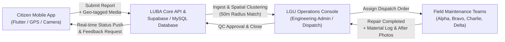

# LUBA CanFindIT · Official User Guide & Operating Manual

> **Quezon City Local Government Unit (LGU) · City Engineering Department**  
> *Pothole Detection, Citizen Reporting, Dispatch Management, and Infrastructure QC System*  
> **System Version:** 2026.1-LTS | **Timezone Standard:** Philippine Standard Time (PHT, UTC+8)

---

## Table of Contents

1. [Executive Overview & Architecture](#1-executive-overview--architecture)
2. [Role Hierarchy & Access Matrix](#2-role-hierarchy--access-matrix)
3. [Citizen Mobile App Guide](#3-citizen-mobile-app-guide)
   - [3.1 Getting Started & Account Setup](#31-getting-started--account-setup)
   - [3.2 Reporting a Road Pothole / Hazard](#32-reporting-a-road-pothole--hazard)
   - [3.3 Offline Reporting & Auto-Queue Sync](#33-offline-reporting--auto-queue-sync)
   - [3.4 Tracking Report Status & Lifecycle](#34-tracking-report-status--lifecycle)
   - [3.5 Exploring the Public Pothole Map](#35-exploring-the-public-pothole-map)
   - [3.6 Rating Completed Repairs & Feedback](#36-rating-completed-repairs--feedback)
4. [LGU Operations & Admin Web Console Guide](#4-lgu-operations--admin-web-console-guide)
   - [4.1 Console Navigation & Overview Dashboard](#41-console-navigation--overview-dashboard)
   - [4.2 Reports Management & Queue Filtering](#42-reports-management--queue-filtering)
   - [4.3 Verification Review & Duplicate Detection Workflow](#43-verification-review--duplicate-detection-workflow)
   - [4.4 Maintenance Team Management & Personnel Administration](#44-maintenance-team-management--personnel-administration)
   - [4.5 Dispatch & Team Work Assignment](#45-dispatch--team-work-assignment)
   - [4.6 Repair Completion QC & Engineering Review](#46-repair-completion-qc--engineering-review)
   - [4.7 Vector Schematic Pothole Map](#47-vector-schematic-pothole-map)
   - [4.8 Analytics, Reporting & Local Data Exports](#48-analytics-reporting--local-data-exports)
   - [4.9 Immutable Audit Logs & System Traceability](#49-immutable-audit-logs--system-traceability)
   - [4.10 Workspace Settings & SLA Configuration](#410-workspace-settings--sla-configuration)
5. [Field Maintenance Crew Guide](#5-field-maintenance-crew-guide)
   - [5.1 Work Order Acceptance & Field Safety Protocols](#51-work-order-acceptance--field-safety-protocols)
   - [5.2 Pre-Repair Staging & Before-Photo Documentation](#52-pre-repair-staging--before-photo-documentation)
   - [5.3 Asphalt Application & Compaction Quality Standards](#53-asphalt-application--compaction-quality-standards)
   - [5.4 Material Logging & After-Photo QC Submission](#54-material-logging--after-photo-qc-submission)
   - [5.5 Handling Rework Returns](#55-handling-rework-returns)
6. [Data Privacy, Security & Governance](#6-data-privacy-security--governance)
7. [Troubleshooting & Frequently Asked Questions (FAQ)](#7-troubleshooting--frequently-asked-questions-faq)
8. [Support & Emergency Escalation](#8-support--emergency-escalation)

---

## 1. Executive Overview & Architecture

**LUBA CanFindIT** is an end-to-end municipal road asset management and hazard mitigation platform built specifically for **Quezon City Local Government Unit (LGU)**. The platform bridges the communication gap between daily motorists/commuters and the **Quezon City Engineering Department**, providing real-time pothole reporting, AI/geospatial duplicate detection, team dispatching, before/after quality inspection, and automated audit logging.



### Core Architecture Components

| Component | Technology | Primary Function |
| :--- | :--- | :--- |
| **Citizen Mobile App** | Flutter (Dart) | Citizen reporting, camera capture, offline caching, push notifications, and public map exploration. |
| **LGU Operations Web Console** | Single Page Web App (HTML5 / Tailwind CSS / Vanilla ES6) | Administrator dashboard, verification review, team dispatch, repair QC review, analytics, and exports. |
| **Backend & Sync Layer** | Node.js (Express), Supabase & MySQL 8.0+ | RESTful APIs, Realtime change subscribers, RBAC authorization, and immutable audit triggers. |
| **Vector Schematic Map** | Native SVG Vector Engine | Self-contained, dependency-free interactive spatial map with severity pin clusters. |

---

## 2. Role Hierarchy & Access Matrix

LUBA CanFindIT strictly enforces the **Principle of Least Privilege (PoLP)** and Philippine **Republic Act 10173 (Data Privacy Act of 2012)**.

| Role | Target Users | Admin Console Access | Report Verification | Team Dispatch | QC Approval | Citizen PII Visibility |
| :--- | :--- | :---: | :---: | :---: | :---: | :---: |
| **LGU Administrator** | Department Heads, IT Directors | **Yes** (Full) | Yes | Yes | Yes | Masked by default (Audit-logged unmasking) |
| **LGU Reviewer / Dispatcher** | Desk Engineers, Dispatch Clerks | **Yes** (Operational) | Yes | Yes | Yes | Masked by default |
| **Maintenance Lead** | Field Engineers, Crew Supervisors | Limited (Tasks/Crew) | No | Self-Roster | Upload QC | No |
| **Maintenance Crew** | Asphalt & Compaction Technicians | Mobile Work Order | No | No | Upload QC | No |
| **Citizen** | General Public, Commuters, Motorists | Mobile App Only | No | No | No | Own data only |

---

## 3. Citizen Mobile App Guide

The **LUBA CanFindIT Mobile App** allows residents and commuters to document road hazards safely and hold the city government accountable with transparent, end-to-end status tracking.

### 3.1 Getting Started & Account Setup

1. **Download & Launch**: Install the application on your Android or iOS device. Launch the app and tap **Get Started** on the welcome screen.
2. **Account Registration**:
   - Provide your **Full Legal Name**, **Email Address**, and valid **Philippine Mobile Number** (`+63 9XX XXX XXXX`).
   - Create a strong password (minimum 8 characters with at least one number and special character).
3. **Email Verification**:
   - Check your inbox for a 6-digit confirmation code.
   - Enter the code in the verification screen to activate your account.
4. **Permissions Configuration**:
   - **Precise Location (GPS)**: Grant *"While using the app"* permission to enable automatic road corridor tagging.
   - **Camera & Storage**: Grant permission to allow photo capture of road surface damage.

---

### 3.2 Reporting a Road Pothole / Hazard

Follow these 5 simple steps to file a report:

```
[ Step 1: Capture Photo ] ➔ [ Step 2: Confirm Location ] ➔ [ Step 3: Assess Severity ] ➔ [ Step 4: Describe ] ➔ [ Submit ]
```

1. **Step 1: Capture Clear Photos**
   - Tap the orange **Report a Pothole** button (`+`) on the bottom navigation bar.
   - Stand in a safe, visible pedestrian or curbside area. **Never take photos while operating a motor vehicle.**
   - Frame the pothole clearly in daylight if possible, showing surrounding road markings for spatial context.
2. **Step 2: Confirm Location & Address**
   - The app reads your hardware GPS coordinates (target accuracy: $\pm 8\text{ meters}$).
   - The interactive mini-map will center on your current position.
   - If the pin is slightly off, drag the pin to center it directly on the pothole.
   - The system automatically detects the **Road Corridor** (e.g., *Commonwealth Avenue*, *Aurora Boulevard*) and **Barangay** (e.g., *Batasan Hills*).
3. **Step 3: Select Citizen-Observed Severity**
   - **Low**: Superficial surface wear, shallow depression ($<2.5\text{ cm}$), minimal traffic disruption.
   - **Medium**: Noticeable asphalt cracking and indentation ($2.5\text{ cm} - 5\text{ cm}$), causes vehicles to brake or swerve.
   - **High**: Deep crater ($>5\text{ cm}$), exposed base gravel or rebar, immediate risk of tire blowout or motorcycle crash.
4. **Step 4: Add Road Context & Landmarks**
   - Add nearby landmarks (e.g., *"In front of Ever Gotesco Northbound lane, near pedestrian overpass"*).
   - Specify whether the hole collects standing rainwater or poses special hazards to cyclists/motorcyclists.
5. **Step 5: Review & Submit**
   - Review your submission summary and tap **Submit Report**.
   - Your report is assigned a permanent public reference code (e.g., `RW-2026-0842`).

---

### 3.3 Offline Reporting & Auto-Queue Sync

When traveling through cellular dead zones or underground underpasses:
1. The app detects network unavailability and activates **Offline Mode**.
2. Photos and GPS coordinates are stored securely in local device storage.
3. Your report enters the **Pending Sync** queue under **My Reports**.
4. Once your mobile device reconnects to Wi-Fi or cellular LTE/5G, the app automatically uploads queued reports in the background without user intervention.

---

### 3.4 Tracking Report Status & Lifecycle

Every report progresses through an **8-State Standard Municipal Lifecycle**:

| Lifecycle Badge | Color Token | Meaning to Citizen |
| :--- | :--- | :--- |
| **Submitted** | `#EAF2FC` (Light Blue) | Report received and queued for desk review by QC Engineering. |
| **Under Review** | `#FFF4D9` (Warm Amber) | An LGU inspector is validating photos, duplicate status, and jurisdiction. |
| **Verified** | `#EAF2FC` (Navy Accent) | Pothole confirmed by engineer. Damage verified for road maintenance. |
| **Assigned** | `#EAF2FC` (Light Blue) | A dedicated maintenance crew (e.g., QC Team Alpha) has been dispatched. |
| **In Progress** | `#EAF2FC` (Blue) | Crew is on-site cutting, filling, and compacting hot-mix asphalt. |
| **Resolved** | `#E8F5EE` (Emerald Green) | Repair completed, inspected, and approved by LGU Quality Assurance. |
| **Rejected** | `#FCECEC` (Soft Red) | Report outside QC jurisdiction, private roadway, or not road damage. |
| **Duplicate** | `#E7ECF2` (Muted Slate) | Linked to an existing active report filed earlier within the same 50m radius. |

> [!NOTE]
> When a report is marked as a **Duplicate**, you still receive real-time updates whenever the parent primary report moves forward to **In Progress** and **Resolved**!

---

### 3.5 Exploring the Public Pothole Map

- Open the **Map** tab from the main menu to see citywide pothole status.
- Pins are color-coded by severity:
  - **Red Pins**: High Severity Hazards.
  - **Yellow Pins**: Medium Severity Potholes.
  - **Blue Pins**: Low Severity Surface Imperfections.
  - **Green Pins**: Recently Resolved & Patched Sites.
- **Privacy Assurance**: Public pins display only the report ID, date, road name, and repair status. Citizen names, phone numbers, and private home addresses are completely redacted from public view.

---

### 3.6 Rating Completed Repairs & Feedback

Once your report reaches **Resolved** status:
1. You will receive an in-app notification: *"Road repair at [Road Name] is complete!"*
2. Tap the notification to open **Rate Repair**.
3. Inspect the official **After Repair** photo uploaded by the engineering crew.
4. Submit a 1 to 5 star rating:
   - **5 Stars**: Perfectly level, seamless transition, road fully cleaned.
   - **3 Stars**: Passable patch, but minor bumps or loose aggregate.
   - **1 Star**: Defective patch, loose debris, or depression already sinking.
5. If rated 1 or 2 stars, your feedback automatically flags the report for a secondary LGU supervisory audit.

---

## 4. LGU Operations & Admin Web Console Guide

The **LUBA CanFindIT Web Operations Console** is the centralized mission control for the **Quezon City Engineering Department**.

### 4.1 Console Navigation & Overview Dashboard

Access the portal via modern desktop browsers (Chrome, Edge, Firefox, Safari) at `http://localhost/LUBACanFindIT/frontend/` (or your internal LGU domain).

#### Screen Layout Dimensions & Theme Tokens
- **Fixed Left Sidebar**: `236px` width in LGU Navy (`#102D4F`).
- **Top Header Bar**: `80px` height with active user profile, district selector, and live PHT clock.
- **Main Viewport Canvas**: Soft ergonomic grey (`#F3F6FA`), maximum content grid `1200px`.

#### Real-Time KPI Cards (Top Row)
1. **Total Reports**: Citywide cumulative reports received during the active fiscal cycle (e.g., `1,284`).
2. **Pending Review**: Unverified reports requiring engineer review (`98 reports need attention`).
3. **Verified**: Validated hazards awaiting crew assignment (`186`).
4. **In Progress**: Active repairs underway on city roads (`214`).
5. **Resolved**: Successfully inspected and closed repairs (`620`).

---

### 4.2 Reports Management & Queue Filtering

Navigate to **Administration / Reports** to view the master incident table.

1. **Filter Pills**: Click between `All reports`, `Needs attention`, `Verified`, `Assigned`, `In Progress`, and `Resolved`.
2. **Text Search**: Enter Report ID (`RW-2026-0842`), Road Name (`Commonwealth`), or Barangay (`Batasan`).
3. **Multi-Dropdown Filters**:
   - Filter by **District** (District 1 through District 6).
   - Filter by **Severity** (High, Medium, Low).
   - Filter by **Reporting Month** (May through October).
4. **Report Actions**: Click any report ID or row to open the complete dossier.

---

### 4.3 Verification Review & Duplicate Detection Workflow

Every newly submitted report must undergo technical desk review before work orders can be generated.

```
[ New Report Received ] ➔ [ Open Verification Review ] ➔ [ Complete 4-Point Checklist ] ➔ [ Approve / Reject / Flag Duplicate ]
```

#### The Mandatory 4-Point Verification Checklist
To approve a report, the reviewing engineer must inspect the citizen photo and verify:
- [x] **Photo Authenticity**: Photo clearly depicts authentic asphalt or concrete road damage.
- [x] **Spatial Alignment**: GPS pin and reverse-geocoded road name correspond to actual roadway geometry.
- [x] **Jurisdiction Check**: Location falls under Quezon City LGU jurisdiction (National DPWH roads and private subdivisions are escalated or rejected).
- [x] **Nearby Duplicate Check**: System evaluates all active reports within a **50-meter radius**.

#### Handling Duplicate Reports (Screens 7 & 8)
- If an existing report is detected nearby (e.g., candidate `RW-2026-0842` vs existing `RW-2026-0819`, 38m apart):
  - Click **Compare Side-by-Side**.
  - Inspect both photos and roadway directions (e.g., Northbound vs Southbound).
  - If identical: Click **Flag as Duplicate** and link to the primary parent report.
  - If distinct: Click **Keep as Distinct Report** and proceed with verification.

#### Final Verification Decision
- **Approve & Mark Verified**: Confirms road hazard severity. Enforces the city policy: *"Verification is not resolution."*
- **Reject Report**: Requires selecting a rejection category (*Outside QC Jurisdiction*, *Private Property*, *Insufficient Damage*, *Vandalism/Spam*) and providing a transparent citizen-facing explanation.

---

### 4.4 Maintenance Team Management & Personnel Administration

Navigate to **Administration / Teams** to supervise asphalt repair units:
- **Team Alpha**: QC North Sector (Commonwealth, Novaliches, Fairview)
- **Team Bravo**: QC Central Sector (Diliman, Quezon Avenue, Timog)
- **Team Charlie**: QC South Sector (Cubao, Aurora Boulevard, New Manila)
- **Team Delta**: QC East Sector (Katipunan, Batasan, Payatas)

#### Adding Field Personnel (Screen 16)
1. Click **+ Add Personnel**.
2. Enter Full Name, Assign Team, and select Member Role (*Crew Lead* or *Crew Technician*).
3. **Philippine Mobile Number Validation**: The field strictly enforces the Philippine mobile standard (`+63 9XX XXX XXXX`). Incomplete numbers trigger a red border (`#B93838`) and disable the save button.
4. **Invitation Expiry**: Personnel invitations automatically expire after **7 days** if unaccepted.

#### Duty Status & Task Handover Protection (Screen 17)
- Personnel can be set to: `On duty`, `Unavailable`, or `On leave`.
- **Active Task Protection**: If a Crew Lead has active repairs in progress, the system prevents setting them to `On leave` until ongoing work orders are formally reassigned to a designated relief engineer via **Review Task Handover**.

---

### 4.5 Dispatch & Team Work Assignment

Once a report is **Verified**, the dispatcher schedules field execution:
1. Open the report and click the orange **Assign Repair Team** button.
2. Select the designated maintenance team based on proximity and specialty (e.g., *QC North · Team Alpha, 2.1 km away*).
3. The assigned Crew Lead (e.g., *Engr. Paolo Santos*) is automatically linked.
4. Set the **Target Completion Date & Time** according to LGU SLA standards.
5. Provide specific **Field & Safety Instructions** (e.g., *"Deploy traffic cones 50m prior to work zone; close outer lane between 10:00 AM and 2:00 PM"*).
6. Click **Confirm Assignment**. Status advances to **Assigned**.

---

### 4.6 Repair Completion QC & Engineering Review

When a maintenance crew completes a field patch, the report enters **Completion Review** (Screen 11).

#### Side-by-Side Photo & Material Reconciliation
- **Before Repair Photo**: Inspect original pothole dimensions, depth, and edge cracking.
- **After Repair Photo**: Inspect asphalt patch smoothness, compaction, and edge sealing.
- **Material Reconciliation**: Review reported hot-mix asphalt consumption (e.g., *4 bags / ~200 kg hot-mix asphalt*), tack coat emulsion, and patch square meterage.

#### 4-Point LGU Engineering Quality Checklist
The reviewing QA Engineer must inspect and check off:
- [x] **Same Site Confirmed**: Background landmarks and road striping confirm the identical location.
- [x] **Full Compaction**: Depressions are fully filled and compacted flush with adjacent pavement.
- [x] **Surface Safety**: Edge joints are sealed; no loose aggregate, sharp drops, or ridges.
- [x] **Documentation Consistency**: Material volume aligns with measured patch area.

#### Review Outcome
- **Approve Repair & Mark Resolved**: Status changes to **Resolved**. The citizen reporter is notified immediately to submit their satisfaction rating.
- **Return to Team for Rework**: If the patch is underfilled or uneven, provide mandatory engineering rework instructions. The crew is redelivered the task for on-site correction.

---

### 4.7 Vector Schematic Pothole Map

Navigate to **Administration / Pothole Map** (Screen 13):
- Built with a **self-contained SVG Vector Engine** representing Quezon City road corridors and districts.
- Zero external mapping API dependencies, zero tile subscription fees, and 100% internal uptime.
- **Filter Pills**: Switch views instantly between `All statuses`, `Open only`, and `Resolved`.
- **Pin Inspector**: Click any map node to display a flyout preview with report ID, corridor name, severity badge, and quick jump to the full dossier.

---

### 4.8 Analytics, Reporting & Local Data Exports

Navigate to **Administration / Analytics** (Screen 20) for operational intelligence:

#### Key Operational Metrics
- **Resolution Rate**: Percentage of verified reports successfully closed (e.g., `48.3%`).
- **Median First Review Time**: Speed of initial engineer verification (Target: $<4\text{ hours}$, Current: `2.4 hours`).
- **Median Repair Time**: Days elapsed from assignment to completed compaction (Target: $<3\text{ days}$, Current: `2.8 days`).
- **Road-Level Summary**: Top damaged corridors ranked by frequency and repair expenditure.

#### Generating CSV & PDF Data Exports (Screens 21–24)
1. Click **Export Data** in the top-right toolbar.
2. Select your file format: **CSV (Spreadsheet Data)** or **PDF Summary Report**.
3. Choose the export scope: **Current Filtered View** or **All Historical Records**.
4. **Date-Range Validation**: The calendar enforces strict chronological validation. Selecting an end date prior to a start date triggers an immediate warning: `Invalid range · end precedes start`.
5. **Data Privacy Default**: The option `Include Citizen Name, Email & Phone` is **unchecked by default**.
6. **Direct Local Download**: Files are generated dynamically and saved straight to your computer's `Downloads` folder (`Content-Disposition: attachment; filename="LUBA canFindIT_QC_YYYY-MM-DD.csv"`). No cloud storage bucket setup is required!

---

### 4.9 Immutable Audit Logs & System Traceability

Navigate to **Administration / Audit Log** (Screen 12):
- Every status transition, personnel assignment, user suspension, and export request is permanently written to `report_status_history` and `system_audit_logs`.
- **Database-Level Immutability**: Protected by four MySQL `BEFORE UPDATE` and `BEFORE DELETE` triggers that throw SQL exceptions if any administrator attempts to tamper with or alter past history.
- **Forensic Detail**: Records exact PHT timestamp, User ID, Full Name, Action Category, Before/After JSON states, and Client IP address.

---

### 4.10 Workspace Settings & SLA Configuration

Super-Administrators can configure municipal policies in **Administration / Settings** (Screen 26):
- **Duplicate Cluster Radius**: Configurable between $20\text{m} - 100\text{m}$ (default: `50 meters`).
- **SLA Resolution Targets**:
  - **High Severity**: `48 hours`
  - **Medium Severity**: `5 days`
  - **Low Severity**: `14 days`
- **Workflow Policies**: Toggle mandatory before/after photo requirements and automated citizen SMS/email notification digests.

---

## 5. Field Maintenance Crew Guide

This section is dedicated to field engineers, crew leads, and asphalt repair workers operating on Quezon City thoroughfares.

### 5.1 Work Order Acceptance & Field Safety Protocols

1. **Morning Briefing**: The Crew Lead reviews daily assigned work orders on the mobile tablet or printed dispatch sheet.
2. **On-Site Safety Setup (Mandatory)**:
   - Park municipal repair vehicles with hazard beacons flashing facing oncoming traffic.
   - Deploy reflective traffic cones at a taper of $30\text{ to }50\text{ meters}$ upstream from the work area.
   - All crew members must wear high-visibility PPE vests, safety boots, and hard hats.

---

### 5.2 Pre-Repair Staging & Before-Photo Documentation

1. Clean loose gravel, standing water, and road dust from the pothole using high-pressure air blowers or wire brooms.
2. Use the mobile app to snap the official **Before Repair Photo** clearly showing the cleaned cavity and road context.
3. Square off the pothole edges vertically using a pavement saw or jackhammer to ensure clean vertical bonding faces.

---

### 5.3 Asphalt Application & Compaction Quality Standards

1. **Tack Coat Application**: Uniformly spray hot asphalt emulsion over the bottom and vertical edges of the cavity.
2. **Asphalt Laydown**: Shovel hot-mix asphalt into the hole in lifts not exceeding $5\text{ cm}$ thick. Rake asphalt to a crown slightly above the existing pavement level to allow for compaction.
3. **Mechanical Compaction**: Compact the patch thoroughly using a vibrating plate compactor or tandem roller until no further wheel indentations are visible.

---

### 5.4 Material Logging & After-Photo QC Submission

1. Once the compacted surface cools, take the official **After Repair Photo** from the exact same camera angle as the before photo.
2. In the mobile completion form, enter:
   - **Bags/Tons of Hot-mix Asphalt Used** (e.g., `4 bags (~200 kg)`).
   - **Patch Dimensions** (Length $\times$ Width in meters).
   - **Compaction Technique** (Plate compactor / Smooth-drum roller).
3. Submit the completion record. The work order immediately appears on the LGU Engineering QC review queue.

---

### 5.5 Handling Rework Returns

If an engineering inspector returns a completion record for rework:
1. Review the inspector's detailed note (e.g., *"Patch surface sunken 1.5 cm below surrounding concrete; re-layer and compact"*).
2. The team returns to the location, applies necessary corrective asphalt, re-compacts, and uploads a fresh After-Repair photo for re-evaluation.

---

## 6. Data Privacy, Security & Governance

LUBA CanFindIT complies with **Philippine Republic Act No. 10173 (Data Privacy Act of 2012)**:

1. **Citizen Personal Identifiable Information (PII)**:
   - Full legal names, personal phone numbers, and email addresses are masked by default across all general operational tables.
   - Access to unmasked citizen information is restricted to authorized LGU personnel with explicit, audited justification logs.
2. **Public Map Redaction**:
   - The public-facing pothole map exposes strictly anonymized incident data. No personal reporter attributes are ever published.
3. **Account Suspension & Privileges**:
   - Administrator accounts cannot be unilaterally deleted. Suspended accounts preserve all historical audit links to past actions.

---

## 7. Troubleshooting & Frequently Asked Questions (FAQ)

### Citizen Mobile App FAQs

#### Q1: Why does the app say my GPS accuracy is low?
**A:** Tall skyscrapers or storm cloud cover can cause GPS satellite multipath interference. Move into an open sky area or manually tap and drag the map pushpin to your exact road position.

#### Q2: Can I report potholes in private subdivisions or villages?
**A:** LUBA CanFindIT is designed for public roads maintained by Quezon City LGU. While you may submit reports for gated subdivisions, LGU reviewers may mark them as *Rejected - Private Jurisdiction* and refer you to your homeowners' association (HOA).

#### Q3: Why was my report marked as a Duplicate?
**A:** Another motorist reported the exact same pothole shortly before you. To avoid duplicate crew dispatch, your report was linked to the active primary case. You will still receive all repair progress notifications!

---

### LGU Web Console FAQs

#### Q4: Why is the "Save & send invitation" button disabled in the Add Personnel modal?
**A:** Check the mobile phone number input. The system requires an exact Philippine mobile format (`+63 9XX XXX XXXX` - 11 digits). If digits are missing, the input border turns red and the submission button remains disabled.

#### Q5: What should I do if an export fails with code `EXP-QC-YYYYMMDD-XXXX`?
**A:** Export timeouts occur when filtering very large date ranges during peak database traffic. Click **Retry Generation**, or reduce your selected date window using the **Date Range** filter.

#### Q6: Can audit logs or status history records ever be deleted by a super-admin?
**A:** No. All audit log tables contain immutable database-level triggers (`BEFORE UPDATE` and `BEFORE DELETE`) that block modification attempts even by root database administrators.

---

## 8. Support & Emergency Escalation

For hazardous road emergencies, structural sinkholes, or major road collapses requiring immediate street closure:

- **Quezon City Emergency Operations Hotline:** `122` / `(02) 8988-4242`
- **City Engineering Department (Road Operations Division):** `engineering@quezoncity.gov.ph`
- **LUBA CanFindIT Technical System Support:** `support@canfindit.qc.gov.ph`
- **Operating Hours:** 24/7 Citizen Reporting | Engineering Desk Review: 7:00 AM – 6:00 PM PHT

---

*LUBA CanFindIT · Quezon City Engineering Department · Safe Roads for Every Filipino.*
